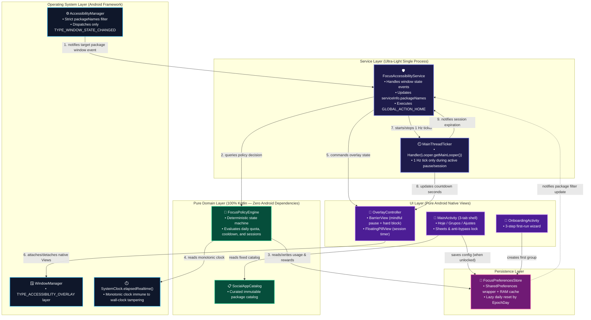
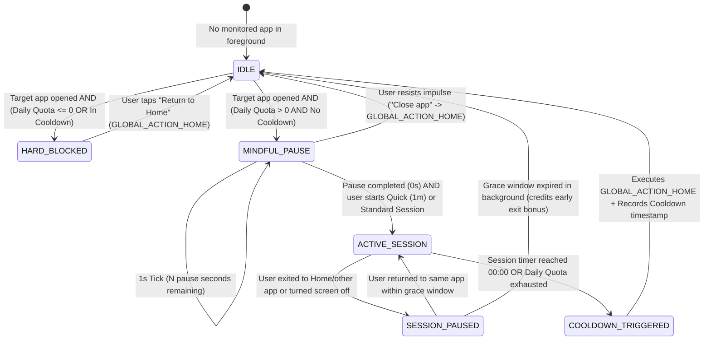

# Architectural Contract — FocusGuard

## 1. Stack & Toolchain

| Layer | Technology Choice | Engineering Rationale (4 GB RAM Target) |
| :--- | :--- | :--- |
| **Language** | Kotlin `2.0+` (JVM Target 17) | Strict static typing, null-safety, and zero runtime overhead when avoiding heavy reflection libraries. |
| **Build System** | Gradle (Kotlin DSL) + Android Gradle Plugin (AGP) | Configured with R8/ProGuard (`isMinifyEnabled = true`, `isShrinkResources = true`) to produce a release APK `< 1.5 MB`. |
| **UI Framework** | **100% Android Native Views (`android.view.*` / `android.widget.*`)** | Zero Jetpack Compose, zero heavy `appcompat` or `material` dependencies. Native `View` classes are preloaded in Android's `Zygote` process, resulting in ~0 MB of library RAM overhead. |
| **Overlay Engine** | `WindowManager` + `TYPE_ACCESSIBILITY_OVERLAY` | Eliminates the separate `SYSTEM_ALERT_WINDOW` permission, delivers `< 50 ms` interception latency, and runs directly within the `AccessibilityService` context. |
| **Concurrency / Timers** | `android.os.Handler(Looper.getMainLooper())` + `SystemClock.elapsedRealtime()` | Eliminates `kotlinx-coroutines-android` (~1.5 MB binary + dispatcher allocations). `Handler.postDelayed` on the Main Thread for a 1 Hz tick has negligible CPU and memory cost. |
| **Persistence** | `android.content.SharedPreferences` (Private Mode) + In-Memory Cache | Instantaneous in-memory reads natively backed by Android XML storage without SQLite/Room or DataStore overhead. |
| **Testing** | JUnit 5 (Local JVM Unit Tests for State Machine & Quota Rules) | All decision logic (`FocusPolicyEngine` and `FocusPreferencesStore`) is decoupled from the Android SDK to execute in milliseconds on the local JVM. |

---

## 2. Architecture & Event Flow Diagram



---

## 3. Intervention State Machine (`FocusPolicyEngine`)



---

## 4. Directory Layout & Modular Boundaries

The project enforces strict separation within a single root package and 4 cohesive subpackages:

- `com.focusguard.app/`
  - `domain/` *(100% pure Kotlin, JVM-testable without an emulator)*
    - `SocialAppCatalog.kt` — Immutable catalog of supported social media apps (`TargetApp`) and lookup maps.
    - `FocusModels.kt` — Core models (`GroupIcon`, `FocusGroup`, `FocusConfig`, `AppUsageState`, `FocusRewardState`, `FocusRewardSummary`, `ActiveSessionSnapshot`, `BlockReason`, `InterventionAction`).
    - `FocusLimits.kt` — Domain limits, ranges, preset matching, session-quota coercion, and quota danger levels.
    - `FocusPolicyEngine.kt` — Pure deterministic state machine (Progressive Pause, 1 Hz Breathing Guide, 1-min Micro-Session, Multi-App Paused Session Map, Voluntary Early-Exit Bonus, and Bitmask Consistency).
    - `WindowExitArbiter.kt` — Pure verdict resolver (`SESSION_VISIBLE` / `SESSION_HIDDEN` / `UNKNOWN`) that answers whether the monitored app still owns a visible `TYPE_APPLICATION` window; it never reads the event package that triggered the sample.
    - `SessionExitTracker.kt` — Pure stateful debouncer that turns 1 Hz verdicts into one confirmed exit (2 hidden ticks, 5 unknown ticks) and resets its streaks on any visible sample.
    - `TimeProvider.kt` — Monotonic clock and local calendar abstraction (`TimeProvider`) plus the `FocusPolicyStore` persistence contract.
  - `data/`
    - `KeyValueBackend.kt` — Minimal storage abstraction (`KeyValueBackend`, `SharedPreferencesBackend`) and `FocusRuntime` process-wide singleton providing shared `FocusPreferencesStore` and `FocusPolicyEngine` instances across activities and `FocusAccessibilityService`.
    - `FocusPreferencesStore.kt` — Ultra-light `SharedPreferences` implementation with in-memory caching, atomic batch commits, lazy daily reset, `consistencyBitmask` rollover, group icon migration, onboarding flag, and stats resets.
  - `service/`
    - `FocusAccessibilityService.kt` — Android `AccessibilityService` implementing the inverted foreground flow: event-driven entry (monitored app opened) and tick-sampled exit (1 Hz `getWindows()` snapshot resolved by `WindowExitArbiter`), plus the launcher/dashboard fast path, dynamic `packageNames` filtering, screen-off/unlock handling, `GLOBAL_ACTION_HOME`, barrier preview, and dashboard session termination.
    - `OverlayController.kt` — Window lifecycle manager over `WindowManager` (`TYPE_ACCESSIBILITY_OVERLAY`), owning only attachment, `FLAG_KEEP_SCREEN_ON`, the floating pill flags (`FLAG_ALT_FOCUSABLE_IM`, zero insets fitting), `ensurePillAttached()` projection of the engine state, and pill self-healing when the OEM detaches the overlay.
    - `DebugEventLog.kt` — Debug-only diagnostics ring buffer (last 100 entries + `Log.d("FocusGuard", …)`) behind a lazy message lambda; the branch is a `static final false` that R8 strips from release builds.
    - `BarrierView.kt` — Full-screen hierarchy shared by the mindful pause (4s breathing ring, quota gauge, progressive CTAs) and the strict hard block (live `mm:ss` countdown, one-line reason, single exit action). Bound in place on every tick.
    - `FloatingPillView.kt` — Compact session pill with monospaced countdown, session-progress track, tap-to-swap-side, and long-press early exit.
    - `MainThreadTicker.kt` — Zero-coroutine 1 Hz countdown wrapper around `Handler(Looper.getMainLooper())`.
  - `ui/`
    - `MainActivity.kt` — Three-tab shell (Hoje, Grupos, Ajustes) with a custom bottom navigation bar, onboarding redirect, sheet orchestration, and anti-bypass lock enforcement.
    - `OnboardingActivity.kt` — Three-step first-run wizard (activate service, choose apps, pick a rhythm).
    - `TodayScreen.kt` — Daily briefing: reclaimed time, resisted impulses, 7-day strip, live session, and per-group limit preview.
    - `GroupsScreen.kt` — Group management with quota gauges, cooldown chips, expandable app usage, and edit/manage entry points.
    - `SettingsScreen.kt` — Service activation guide, barrier preview, anchor habit, data resets, and privacy/version info.
    - `design/Theme.kt` — Warm Dusk tokens (`Palette`, `TypeScale`, `Space`, `Radius`, `Motion`), dp/insets helpers, haptics, and reduced-motion detection.
    - `design/UiKit.kt` — Native primitives: buttons, cards, section headers, chips, monograms, switches, seekbars, inputs, empty states, and `QuotaBarView`.
    - `presenter/DashboardPresenter.kt` — Maps stores and the engine into immutable `TodayState` / `SettingsState` / `GroupLimitState` snapshots and formatting helpers.
    - `BottomSheet.kt` — Native bottom sheet dialog with drag handle, scrollable body, hairline divider, and sticky action footer.
    - `ConfirmSheet.kt` — Explicit destructive confirmation sheet.
    - `ReclaimedCardView.kt` — Daily hero card with reclaimed minutes, resisted impulses, tangible equivalence, and a 7-day consistency strip.
    - `ServiceStatusCard.kt` — Compact (Hoje) and detailed (Ajustes/onboarding) accessibility-service card with activation steps and barrier test.
    - `GroupCardView.kt` — Expandable group card with isolated switch, numeric quota, semantic chip, and per-app rows.
    - `GroupConfigSheet.kt` — Group identity (name + vector icon), presets, rhythm sliders, shared-quota behavior, and destructive delete.
    - `AppPickerSheet.kt` — Native bottom sheet with live search for adding/moving apps across groups.
    - `AnchorHabitSheet.kt` — Native bottom sheet with radio choices and custom input for positive anchor habits.
    - `AnchorHabitCardView.kt` — Settings card showing the current anchor habit.
    - `GroupIconResources.kt` — Maps the stable `GroupIcon` keys to vector drawables.
    - `InstalledAppScanner.kt` — On-demand scanner querying `PackageManager` for launchable user apps without background overhead.

---

## 5. Core Domain Contracts (`domain`)

```kotlin
package com.focusguard.app.domain

/** Stable persisted key + curated vector icon (legacy emoji migration on read). */
enum class GroupIcon(val key: String, val label: String, val legacyEmoji: String) {
    SOCIAL("social", "Redes sociais", "📱"),
    GAMES("games", "Jogos", "🎮"),
    VIDEO("video", "Vídeos e streaming", "🎬"),
    SHOPPING("shopping", "Compras", "🛒"),
    NEWS("news", "Notícias", "📰"),
    CHAT("chat", "Mensagens", "💬"),
    WORK("work", "Trabalho", "💼"),
    STUDY("study", "Estudos", "📚"),
    MUSIC("music", "Música", "🎵"),
    BROWSER("browser", "Navegador", "🌐"),
    CUSTOM("custom", "Outro", "🎯");

    companion object {
        fun fromStored(raw: String?): GroupIcon
    }
}

data class FocusGroup(
    val id: String,
    val name: String,
    val iconKey: String = GroupIcon.SOCIAL.key,
    val enabled: Boolean = true,
    val appIds: Set<String> = emptySet(),
    val mindfulPauseSeconds: Int = 10,
    val sessionDurationMinutes: Int = 5,
    val cooldownMinutes: Int = 10,
    val dailyQuotaMinutes: Int = 30,
    val progressivePauseEnabled: Boolean = true,
    val sharedQuota: Boolean = true
) {
    val sessionDurationSeconds: Long get() = sessionDurationMinutes * 60L
    val cooldownSeconds: Long get() = cooldownMinutes * 60L
    val dailyQuotaSeconds: Long get() = dailyQuotaMinutes * 60L
    val icon: GroupIcon get() = GroupIcon.fromStored(iconKey)
}

data class TargetApp(
    val id: String,
    val displayName: String,
    val packageNames: Set<String>,
    val brandColorHex: String = "#38BDF8",
    val isCustom: Boolean = false
)

data class FocusConfig(
    val enabledAppIds: Set<String> = setOf("instagram", "tiktok"),
    val mindfulPauseSeconds: Int = 10,
    val sessionDurationMinutes: Int = 5,
    val cooldownMinutes: Int = 10,
    val dailyQuotaMinutes: Int = 30,
    val progressivePauseEnabled: Boolean = true,
    val selectedAnchorHabit: String = DEFAULT_ANCHOR_HABIT,
    val groups: List<FocusGroup> = emptyList(),
    val customApps: List<TargetApp> = emptyList(),
    val sharedQuotaEnabled: Boolean = true
)

/** Read-only dashboard snapshot of an active or background-paused session. */
data class ActiveSessionSnapshot(
    val appId: String,
    val displayName: String,
    val groupName: String,
    val remainingSeconds: Long,
    val totalSeconds: Long
)

sealed interface InterventionAction {
    data object DismissOverlay : InterventionAction
    data object NoOp : InterventionAction

    data class KickToHome(val appId: String, val reason: BlockReason) : InterventionAction

    data class ShowHardBlock(
        val appId: String,
        val displayName: String,
        val reason: BlockReason,
        val remainingBlockSeconds: Long,
        val groupName: String = ""
    ) : InterventionAction

    data class ShowMindfulPause(
        val appId: String,
        val displayName: String,
        val remainingPauseSeconds: Int,
        val readyToStartSession: Boolean,
        val remainingDailyQuotaSeconds: Long,
        val breathingCue: String = "",
        val anchorActionLabel: String = "Fechar e voltar ao que importa",
        val rewardBannerText: String = "",
        val reclaimedMinutesOnAbort: Int = 5,
        val allowQuickMicroSession: Boolean = false,
        val groupName: String = "",
        val sessionDurationMinutes: Int = 15
    ) : InterventionAction

    data class ShowFloatingTimer(
        val appId: String,
        val displayName: String,
        val remainingSessionSeconds: Long,
        val remainingDailyQuotaSeconds: Long,
        val groupName: String = "",
        val totalSessionSeconds: Long = 0L
    ) : InterventionAction
}

enum class BlockReason {
    COOLDOWN_ACTIVE,
    DAILY_QUOTA_EXCEEDED
}
```

---

## 6. Extreme Optimization Strategies for 4 GB RAM Devices

1. **Zero UI Library Dependencies (`androidx.appcompat` & `com.google.android.material` excluded):**
   - `MainActivity` inherits directly from `android.app.Activity` using the native system theme (`android:Theme.DeviceDefault.NoActionBar`).
   - Saves ~8 MB of DEX memory in RAM and keeps cold activity startup under `< 40 ms`.
2. **Transient Window Filtering (Anti-Event-Spam):**
   - Virtual keyboards (`Gboard`, `Samsung Honeyboard`, `SwiftKey`) and system overlays (`SystemUI`, `PermissionController`) emit `TYPE_WINDOW_STATE_CHANGED` while the user is typing inside a monitored app.
   - `FocusAccessibilityService` ignores transient IME/system packages and non-interactive screen states (`PowerManager.isInteractive == false`) so active sessions are neither falsely reset nor drained while the screen is off.
   - Any remaining unknown package (e.g. One UI keyboard helpers) can never pause the session: while a session counts, the service samples the interactive window list once per second and `WindowExitArbiter` resolves it into `SESSION_VISIBLE`, `SESSION_HIDDEN` or `UNKNOWN`. `SessionExitTracker` confirms an exit only after 2 hidden samples (~2 s) or 5 unknown samples (~5 s), while the launcher/dashboard fast path pauses immediately.
   - Entry stays event-driven: only a monitored package (or an alias) reaches the engine on `TYPE_WINDOW_STATE_CHANGED`; every other window (IME, autofill, OEM helper, third-party app) is discarded before the state machine is touched.
   - The overlay is a projection of the engine state: `OverlayController.ensurePillAttached()` drops a detached pill before each render, so "session counting" always implies "pill on screen".
3. **Dynamic OS-Level Package Filtering:**
   - When idle, `serviceInfo.packageNames` is restricted solely to `enabledPackages`, keeping FocusGuard at `0.0%` CPU during normal phone usage.
   - Broad window-transition listening (`packageNames = null`) is activated strictly while a session or pause barrier is live in order to detect home/app exits immediately without background polling.

---

## 7. UI Design System — "Warm Dusk" (v2.0)

### 7.1 Tokens (`ui/design/Theme.kt`)

| Token | Value | Role |
| :--- | :--- | :--- |
| `Palette.CANVAS` | `#12100E` | Window background |
| `Palette.SURFACE` | `#1C1815` | Cards and sheets |
| `Palette.ELEVATED` | `#27211C` | Inputs, chips, secondary buttons |
| `Palette.SUNKEN` | `#171310` | Progress tracks |
| `Palette.HAIRLINE` | `#3A322B` | 1dp dividers |
| `Palette.ACCENT` | `#E9B872` | Primary action, selection, focus |
| `Palette.SAGE` | `#9CC5A1` | Success, within quota |
| `Palette.WARN` | `#E08A4C` | Quota warning |
| `Palette.DANGER` | `#D9635A` | Cooldown, destructive actions |
| `TypeScale` | `11 → 40sp` | Overline, caption, label, body, title, display, timer |
| `Space` | `4 → 48dp` | 8pt spacing grid (with 4dp micro-steps) |
| `Radius` | `10 / 14 / 20 / pill` | Buttons, cards, sheets, chips |

`Theme` also exposes `dp()`, `applyInsets()` (edge-to-edge with a single listener per host view), `isReducedMotion()` (reads `ANIMATOR_DURATION_SCALE`), the `View.hapticLight()` / `View.hapticConfirm()` extensions, and the shared `formatClock()` (`mm:ss`) used by the barrier, the floating pill and the dashboard.

### 7.2 Primitives (`ui/design/UiKit.kt`)

`button()` (primary / secondary / ghost / danger), `sectionHeader()`, `statusChip()`, `monogram()`, `themedSwitch()`, `themedCheckBox()`, `themedSeekBar()`, `inputField()`, `emptyState()`, and `QuotaBarView` (in-place ratio/color updates with zero re-allocation on refresh).

### 7.3 Navigation & State Flow

- `MainActivity` is a shell only: it owns the three screens, the custom bottom navigation, the onboarding redirect, and every configuration mutation.
- `DashboardPresenter` converts store/engine queries into immutable `TodayState`, `SettingsState` and `GroupLimitState` snapshots plus the seven-day `dayLabels` used by the consistency strip.
- Each screen exposes `bind(state)` and rebuilds only its own subtree; `GroupsScreen` preserves expanded group ids across refreshes, and `TodayScreen` preserves scroll position.
- Sheets (`GroupConfigSheet`, `AppPickerSheet`, `AnchorHabitSheet`, `ConfirmSheet`) are `Dialog` subclasses with `WindowManager.LayoutParams.MATCH_PARENT` width and a sticky footer.

### 7.4 Overlay Composition

- `OverlayController` never builds views. It attaches/detaches `BarrierView` and `FloatingPillView`, and toggles `FLAG_KEEP_SCREEN_ON` while the pause is counting down.
- `BarrierView` is created once per barrier session and rebound in place every second; the breathing ring animator is paused/cancelled on `dismissAll()`.
- The strict hard block reuses the same hierarchy but hides the ring, cue, quota gauge and session CTAs, leaving only a lock badge, the live countdown (or `Amanhã`), a one-line reason and the single exit action.
- Preview mode (`renderPreview()`) reuses the real barrier with representative data and dismisses on any action, so the settings screen can validate the design without mutating engine state.
- The floating pill keeps `FLAG_NOT_FOCUSABLE | FLAG_NOT_TOUCH_MODAL | FLAG_ALT_FOCUSABLE_IM` so IME windows never conflict with the session timer.

### 7.5 Zero-Bloat Guardrails

- No new runtime dependencies: no AndroidX, no Compose, no Material, no navigation library.
- All icons are hand-written vector drawables (`res/drawable/ic_*.xml`, 19 files) tinted at runtime; unused resources are pruned.
- Emoji were removed from domain copy and group identity; `GroupIcon` persists a stable key and migrates legacy emoji on read.
- Release APK budget: `< 1.5 MB` (currently `~130 KB` with R8 + resource shrinking).
