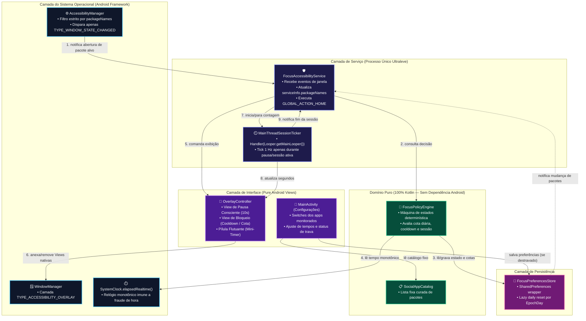
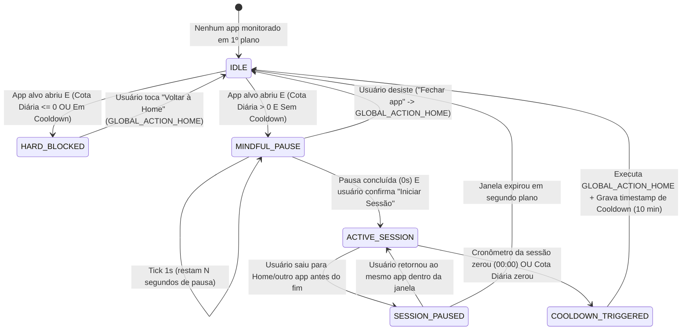

# Architectural Contract — FocusGuard

## 1. Stack & Toolchain

| Camada | Escolha Tecnológica | Justificativa de Engenharia (Foco em 4 GB RAM) |
| :--- | :--- | :--- |
| **Linguagem** | Kotlin `2.0+` (JVM Target 17) | Tipagem estrita, null-safety e zero overhead em tempo de execução quando evitadas bibliotecas pesadas de reflexão. |
| **Build System** | Gradle (Kotlin DSL) + Android Gradle Plugin (AGP) | Habilitado com R8/ProGuard (`isMinifyEnabled = true`, `isShrinkResources = true`) para gerar APK `< 1.5 MB`. |
| **UI Framework** | **100% Android Native Views (`android.view.*` / `android.widget.*`)** | Zero Jetpack Compose, zero `appcompat` ou `material` pesados. As classes de View nativas já estão carregadas no processo `Zygote` do Android, resultando em ~0 MB de overhead de biblioteca. |
| **Overlay Engine** | `WindowManager` + `TYPE_ACCESSIBILITY_OVERLAY` | Dispensa a permissão separada `SYSTEM_ALERT_WINDOW`, tem latência zero (`< 50 ms`) e roda direto no contexto do `AccessibilityService`. |
| **Concorrência / Timers** | `android.os.Handler(Looper.getMainLooper())` + `SystemClock.elapsedRealtime()` | Elimina a dependência de `kotlinx-coroutines-android` (~1.5 MB + alocação de dispatchers). `Handler.postDelayed` na Main Thread para um tick de 1 Hz (1 vez por segundo) tem custo de CPU e memória desprezível. |
| **Persistência** | `android.content.SharedPreferences` (Modo Privado) | Leitura em memória instantânea suportada nativamente pelo Android sem precisar de SQLite/Room ou DataStore. |
| **Testes** | JUnit 5 (Unitários na JVM para a Máquina de Estados e Regras de Cota) | Toda a lógica de decisão (`SessionEngine` e `QuotaRepository`) é desacoplada do SDK do Android para rodar testes em milissegundos na JVM local. |

---

## 2. Diagrama de Arquitetura e Fluxo de Eventos



---

## 3. Máquina de Estados de Intervenção (`FocusPolicyEngine`)



---

## 4. Estrutura de Diretórios e Fronteiras Modulares

O projeto segue separação estrita em pacote único com 4 subpacotes coesos:

- `com.focusguard.app/`
  - `domain/` *(100% Kotlin puro, testável na JVM sem emulador)*
    - `SocialAppCatalog.kt` — Definição imutável das redes sociais suportadas.
    - `FocusConfig.kt` — Modelo de configuração (tempos de pausa, sessão, cooldown, cota diária e pacotes ativos).
    - `AppUsageState.kt` — Estado diário e de cooldown de cada pacote.
    - `FocusPolicyEngine.kt` — Máquina de estados pura que recebe `(packageName, nowEpochMs, todayEpochDay)` e retorna a `InterventionAction`.
    - `TimeProvider.kt` — Interface para injeção de tempo monotônico e calendário local nos testes.
  - `data/`
    - `FocusPreferencesStore.kt` — Implementação enxuta sobre `SharedPreferences` com *lazy daily reset*.
  - `service/`
    - `FocusAccessibilityService.kt` — Serviço de acessibilidade do Android; gerencia o ciclo de vida, filtro `packageNames` e `GLOBAL_ACTION_HOME`.
    - `OverlayController.kt` — Constrói e gerencia as Views nativas no `WindowManager` (`TYPE_ACCESSIBILITY_OVERLAY`) reciclando instâncias quando necessário e desanexando imediatamente ao sair.
    - `MainThreadTicker.kt` — Wrapper sobre `Handler(Looper.getMainLooper())` para contagem regressiva sem alocação de coroutines.
  - `ui/`
    - `MainActivity.kt` — Tela de configuração construída com Views nativas (`ScrollView`, `LinearLayout`, `Switch`, `TextView`, `Button`), exibindo consumo do dia e aplicando a trava anti-sabotagem.

---

## 5. Contratos e Interfaces Principais (`domain`)

```kotlin
package com.focusguard.app.domain

data class TargetApp(
    val packageName: String,
    val displayName: String
)

data class FocusConfig(
    val enabledPackages: Set<String>,
    val mindfulPauseSeconds: Int = 10,
    val sessionDurationMinutes: Int = 5,
    val cooldownMinutes: Int = 10,
    val dailyQuotaMinutes: Int = 30
)

sealed interface InterventionAction {
    /** Pacote não é monitorado ou é o próprio FocusGuard/Launcher */
    data object Ignore : InterventionAction

    /** Bloqueio imediato: cota diária esgotada ou em período de cooldown */
    data class ShowHardBlock(
        val packageName: String,
        val displayName: String,
        val reason: BlockReason,
        val remainingBlockSeconds: Long
    ) : InterventionAction

    /** Barreira de respiração/pausa consciente antes de liberar a sessão */
    data class ShowMindfulPause(
        val packageName: String,
        val displayName: String,
        val pauseSeconds: Int,
        val remainingDailyQuotaSeconds: Long
    ) : InterventionAction

    /** Sessão liberada em andamento com pílula flutuante */
    data class ContinueSession(
        val packageName: String,
        val remainingSessionSeconds: Long,
        val remainingDailyQuotaSeconds: Long
    ) : InterventionAction
}

enum class BlockReason {
    COOLDOWN_ACTIVE,
    DAILY_QUOTA_EXCEEDED
}
```

---

## 6. Estratégias de Otimização Extrema para 4 GB de RAM

1. **Zero Dependências de UI (`androidx.appcompat` / `com.google.android.material` removidos):**
   - A `MainActivity` herda diretamente de `android.app.Activity` usando o tema nativo do sistema (`android:Theme.DeviceDefault.NoActionBar`).
   - Economiza ~8 MB de código DEX na memória RAM e reduz o tempo de abertura da tela de configuração para `< 40 ms`.
2. **Prevenção de Falsos Eventos de Janela (Anti-Spam de Eventos):**
   - Teclados virtuais (`com.google.android.inputmethod.latin`, Gboard, Samsung Keyboard) e diálogos do sistema (`com.android.systemui`) disparam `TYPE_WINDOW_STATE_CHANGED` mesmo enquanto o usuário está dentro do Instagram.
   - O `FocusAccessibilityService` ignora eventos de janelas de método de entrada (IME) e janelas do próprio overlay para não interromper nem reiniciar a sessão ativa.
3. **Filtro Dinâmico de Pacotes no Kernel/Framework:**
   - Sempre que `enabledPackages` é alterado no `SharedPreferences`, o serviço chama `setServiceInfo(info.apply { packageNames = enabledPackages.toTypedArray() + launcherPackages })`.
   - Incluímos o pacote do Launcher padrão na escuta apenas para saber o exato instante em que o usuário saiu da rede social e voltou para a tela inicial, permitindo pausar o cronômetro e remover a pílula flutuante sem fazer *polling*.
