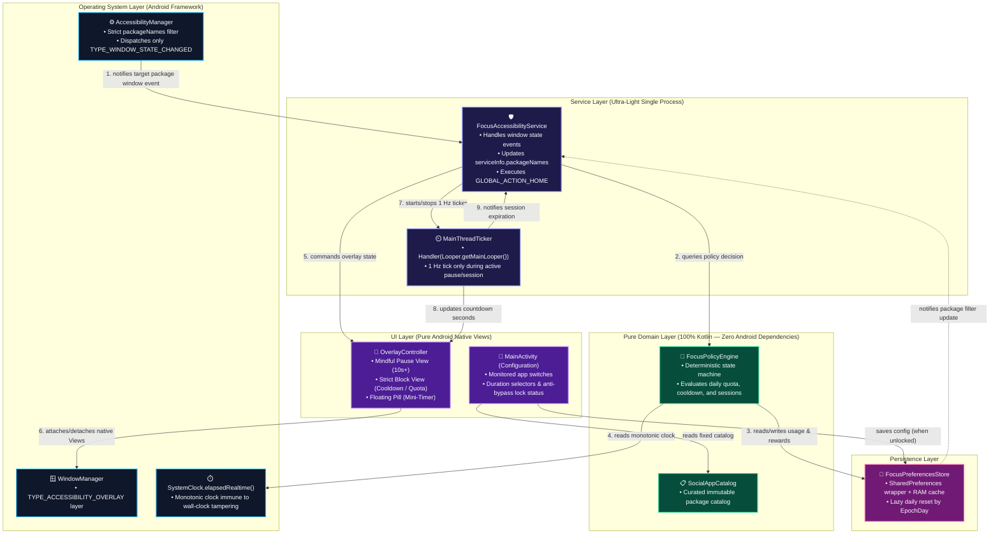
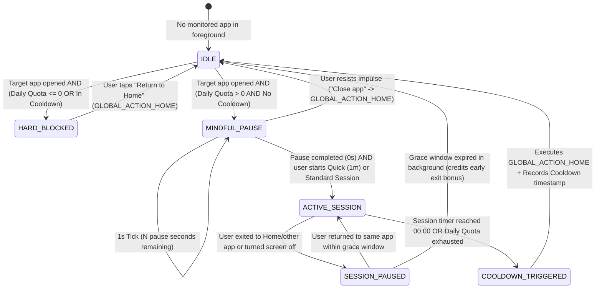

# Architectural Contract — FocusGuard

## 1. Stack & Toolchain

| Layer | Technology Choice | Engineering Rationale (4 GB RAM Target) |
| :--- | :--- | :--- |
| **Language** | Kotlin `2.0+` (JVM Target 17) | Strict static typing, null-safety, and zero runtime overhead when avoiding heavy reflection libraries. |
| **Build System** | Gradle (Kotlin DSL) + Android Gradle Plugin (AGP) | Configured with R8/ProGuard (`isMinifyEnabled = true`, `isShrinkResources = true`) to produce a release APK `< 1.5 MB`. |
| **UI Framework** | **100% Android Native Views (`android.view.*` / `android.widget.*`)** | Zero Jetpack Compose, zero heavy `appcompat` or `material` dependencies. Native `View` classes are preloaded in Android's `Zygote` process, resulting in ~0 MB of library RAM overhead. |
| **Overlay Engine** | `WindowManager` + `TYPE_ACCESSIBILITY_OVERLAY` | Eliminates the separate `SYSTEM_ALERT_WINDOW` permission, delivers `< 50 ms` interception latency, and runs directly within the `AccessibilityService` context. |
| **Concurrency / Timers** | `android.os.Handler(Looper.getMainLooper())` + `SystemClock.elapsedRealtime()` | Eliminates `kotlinx-coroutines-android` (~1.5 MB binary + dispatcher allocations). `Handler.postDelayed` on the Main Thread for a 1 Hz tick has negligible CPU and memory cost. |
| **Persistence** | `android.content.SharedPreferences` (Private Mode) + In-Memory Cache | Instantaneous in-memory reads natively backed by Android XML storage without SQLite/Room or DataStore overhead. |
| **Testing** | JUnit 5 (Local JVM Unit Tests for State Machine & Quota Rules) | All decision logic (`FocusPolicyEngine` and `FocusPreferencesStore`) is decoupled from the Android SDK to execute in milliseconds on the local JVM. |

---

## 2. Architecture & Event Flow Diagram



---

## 3. Intervention State Machine (`FocusPolicyEngine`)



---

## 4. Directory Layout & Modular Boundaries

The project enforces strict separation within a single root package and 4 cohesive subpackages:

- `com.focusguard.app/`
  - `domain/` *(100% pure Kotlin, JVM-testable without an emulator)*
    - `SocialAppCatalog.kt` — Immutable catalog of supported social media apps (`TargetApp`) and lookup maps.
    - `FocusModels.kt` — Core models (`FocusConfig`, `AppUsageState`, `FocusRewardState`, `FocusRewardSummary`, `BlockReason`, `InterventionAction`).
    - `FocusPolicyEngine.kt` — Pure deterministic state machine (Progressive Pause, 1 Hz Breathing Guide, 1-min Micro-Session, Multi-App Paused Session Map, Voluntary Early-Exit Bonus, and Bitmask Consistency).
    - `TimeProvider.kt` — Monotonic clock and local calendar abstraction (`TimeProvider`) plus the `FocusPolicyStore` persistence contract.
  - `data/`
    - `KeyValueBackend.kt` — Minimal storage abstraction (`KeyValueBackend`, `SharedPreferencesBackend`) and `FocusRuntime` process-wide singleton providing shared `FocusPreferencesStore` and `FocusPolicyEngine` instances across `MainActivity` and `FocusAccessibilityService`.
    - `FocusPreferencesStore.kt` — Ultra-light `SharedPreferences` implementation with in-memory caching, atomic batch commits, lazy daily reset, and `consistencyBitmask` rollover.
  - `service/`
    - `FocusAccessibilityService.kt` — Android `AccessibilityService` managing lifecycle, dynamic `packageNames` filtering, interactive window & IME detection, screen-off/unlock handling, and `GLOBAL_ACTION_HOME`.
    - `OverlayController.kt` — Programmatic native `View` manager over `WindowManager` (`TYPE_ACCESSIBILITY_OVERLAY`) with cached drawables, dynamic `FLAG_KEEP_SCREEN_ON`, haptic celebration, micro-session button, and interactive floating pill (tap to swap corner, long-press to finish early with bonus).
    - `MainThreadTicker.kt` — Zero-coroutine 1 Hz countdown wrapper around `Handler(Looper.getMainLooper())`.
  - `ui/`
    - `MainActivity.kt` — Pure `android.app.Activity` configuration screen featuring the Bento dashboard, group cards, and anti-bypass lock enforcement.
    - `InstalledAppScanner.kt` — On-demand scanner querying `PackageManager` for launchable user apps without background overhead.
    - `AppPickerDialog.kt` — Programmatic dark-themed modal dialog with real-time search for assigning installed apps to focus groups.
    - `GroupConfigDialog.kt` — Programmatic modal dialog for editing category parameters (emoji, presets, shared quotas, session timers, cooldown).

---

## 5. Core Domain Contracts (`domain`)

```kotlin
package com.focusguard.app.domain

data class FocusGroup(
    val id: String,
    val name: String,
    val iconEmoji: String = "📱",
    val enabled: Boolean = true,
    val appIds: Set<String> = emptySet(),
    val mindfulPauseSeconds: Int = 10,
    val sessionDurationMinutes: Int = 5,
    val cooldownMinutes: Int = 10,
    val dailyQuotaMinutes: Int = 30,
    val progressivePauseEnabled: Boolean = true,
    val sharedQuota: Boolean = true
) {
    val sessionDurationSeconds: Long get() = sessionDurationMinutes * 60L
    val cooldownSeconds: Long get() = cooldownMinutes * 60L
    val dailyQuotaSeconds: Long get() = dailyQuotaMinutes * 60L
}

data class TargetApp(
    val id: String,
    val displayName: String,
    val packageNames: Set<String>,
    val brandColorHex: String = "#38BDF8",
    val isCustom: Boolean = false
)

data class FocusConfig(
    val enabledAppIds: Set<String> = setOf("instagram", "tiktok"),
    val mindfulPauseSeconds: Int = 10,
    val sessionDurationMinutes: Int = 5,
    val cooldownMinutes: Int = 10,
    val dailyQuotaMinutes: Int = 30,
    val progressivePauseEnabled: Boolean = true,
    val selectedAnchorHabit: String = DEFAULT_ANCHOR_HABIT,
    val groups: List<FocusGroup> = emptyList(),
    val customApps: List<TargetApp> = emptyList(),
    val sharedQuotaEnabled: Boolean = true
)

sealed interface InterventionAction {
    /** Ignored package or return to Launcher; hides any active overlay. */
    data object DismissOverlay : InterventionAction

    /** Irrelevant transient window event (e.g. soft keyboard / popup over active session); preserves state. */
    data object NoOp : InterventionAction

    /** Immediately closes the target app via GLOBAL_ACTION_HOME. */
    data class KickToHome(
        val appId: String,
        val reason: BlockReason
    ) : InterventionAction

    /** Strict block screen when cooldown is active or daily quota is exhausted. */
    data class ShowHardBlock(
        val appId: String,
        val displayName: String,
        val reason: BlockReason,
        val remainingBlockSeconds: Long,
        val groupName: String = ""
    ) : InterventionAction

    /** Mindful breathing/pause barrier before unlocking a session. */
    data class ShowMindfulPause(
        val appId: String,
        val displayName: String,
        val remainingPauseSeconds: Int,
        val readyToStartSession: Boolean,
        val remainingDailyQuotaSeconds: Long,
        val breathingCue: String = "",
        val anchorActionLabel: String = "Fechar e voltar ao que importa",
        val rewardBannerText: String = "",
        val reclaimedMinutesOnAbort: Int = 5,
        val allowQuickMicroSession: Boolean = false,
        val groupName: String = ""
    ) : InterventionAction

    /** Active unlocked session: compact floating pill. */
    data class ShowFloatingTimer(
        val appId: String,
        val displayName: String,
        val remainingSessionSeconds: Long,
        val remainingDailyQuotaSeconds: Long,
        val groupName: String = ""
    ) : InterventionAction
}
        val remainingPauseSeconds: Int,
        val readyToStartSession: Boolean,
        val remainingDailyQuotaSeconds: Long,
        val breathingCue: String = "",
        val anchorActionLabel: String = "Fechar e voltar ao que importa",
        val rewardBannerText: String = "",
        val reclaimedMinutesOnAbort: Int = 5,
        val allowQuickMicroSession: Boolean = false
    ) : InterventionAction

    /** Active unlocked session with discrete floating timer pill. */
    data class ShowFloatingTimer(
        val appId: String,
        val displayName: String,
        val remainingSessionSeconds: Long,
        val remainingDailyQuotaSeconds: Long
    ) : InterventionAction
}

enum class BlockReason {
    COOLDOWN_ACTIVE,
    DAILY_QUOTA_EXCEEDED
}
```

---

## 6. Extreme Optimization Strategies for 4 GB RAM Devices

1. **Zero UI Library Dependencies (`androidx.appcompat` & `com.google.android.material` excluded):**
   - `MainActivity` inherits directly from `android.app.Activity` using the native system theme (`android:Theme.DeviceDefault.NoActionBar`).
   - Saves ~8 MB of DEX memory in RAM and keeps cold activity startup under `< 40 ms`.
2. **Transient Window Filtering (Anti-Event-Spam):**
   - Virtual keyboards (`Gboard`, `Samsung Honeyboard`, `SwiftKey`) and system overlays (`SystemUI`, `PermissionController`) emit `TYPE_WINDOW_STATE_CHANGED` while the user is typing inside a monitored app.
   - `FocusAccessibilityService` ignores transient IME/system packages and non-interactive screen states (`PowerManager.isInteractive == false`) so active sessions are neither falsely reset nor drained while the screen is off.
3. **Dynamic OS-Level Package Filtering:**
   - When idle, `serviceInfo.packageNames` is restricted solely to `enabledPackages`, keeping FocusGuard at `0.0%` CPU during normal phone usage.
   - Broad window-transition listening (`packageNames = null`) is activated strictly while a session or pause barrier is live in order to detect home/app exits immediately without background polling.
